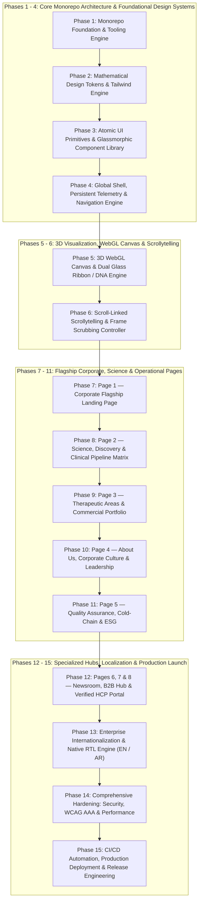

# Mirage Pharma — Comprehensive 15-Phase Frontend Engineering Roadmap

> **Standard:** Enterprise Tier-1 Life Sciences & Biotechnology Digital Platform.  
> **Brand:** MIRAGE PHARMA (*"Healthy Life"* — Values-led, Performance-driven).  
> **Architecture:** Turborepo Monorepo, Next.js 15+ (App Router), TypeScript Strict, Tailwind CSS, Three.js / WebGL / GSAP ScrollTrigger, Playwright, Vitest, Vercel Edge.  
> **Engineering Rigor:** Every single tier across all 15 phases integrates mandatory **Functional Delivery**, **Security & Compliance Controls**, **Performance Benchmarks**, **Testing Verification**, and **DevOps / CI/CD Gates**.

---

---

## Phase 1: Monorepo Foundation, Environment Setup & Tooling Architecture
*Target: Establish a reproducible, multi-package monorepo workspace with strict compiler flags, package-manager integrity, and automated developer ergonomics.*

### Tier 1.1 — Workspace & Package Manager Orchestration
* **Implementation:** Configure `pnpm-workspace.yaml` isolating `apps/*`, `packages/*`, and `backend`. Pin `packageManager` to `pnpm@10.x` with `engines` requirements.
* **Security & Compliance:** Run automated `pnpm audit --audit-level=high`. Enforce lockfile freezing (`--frozen-lockfile`) in all container and CI contexts to prevent supply-chain dependency hijacking.
* **Performance:** Configure pnpm content-addressable storage symlinking to eliminate duplicate node_modules across workspaces.
* **Testing:** Run validation scripts verifying circular dependency absence (`madge --circular apps/ packages/`).
* **DevOps:** Establish Docker multi-stage baseline Dockerfile for isolated workspace cache layers.

### Tier 1.2 — Strict TypeScript & Compiler Config Cadence
* **Implementation:** Construct hierarchical `tsconfig.base.json` extended by packages. Enforce strict type-checking (`strict: true`, `noImplicitAny: true`, `exactOptionalPropertyTypes: true`, `noUncheckedIndexedAccess: true`). Configure path aliases `@mirage/ui`, `@mirage/types`, `@mirage/utils`.
* **Security & Compliance:** Disallow unsafe `any` casts and disable `eval` and prototype pollution vectors via ESLint AST validation rules.
* **Performance:** Enable `incremental: true` with persistent `tsbuildinfo` caching to ensure compile cycles complete in `< 1.2s`.
* **Testing:** Vitest type-level regression tests (`expectTypeOf()` assertions) for domain entities.
* **DevOps:** Add Turbo task `"type-check": { "dependsOn": ["^type-check"] }` ensuring zero type drift in pull request workflows.

### Tier 1.3 — Code Quality, AST Linting & Git Hook Gateways
* **Implementation:** Standardize ESLint v9 Flat Config with React 19 rules, Tailwind CSS sorting plugin, and Prettier integration. Configure Lefthook / Husky for lightning-fast pre-commit executions.
* **Security & Compliance:** Integrate `secretlint` in pre-commit hooks to block API keys, tokens, or private credentials from entering source control.
* **Performance:** Pre-commit hooks scoped strictly to staged files using `lint-staged` with execution threshold `< 400ms`.
* **Testing:** Lint execution benchmark verifying zero warnings or suppressed lint comments (`--max-warnings=0`).
* **DevOps:** Turbo remote cache configuration via Vercel / self-hosted cache server to cut CI build times by over 70%.

---

## Phase 2: Mathematical Design Tokens & Tailwind CSS Engine
*Target: Translate Mirage Pharma's brand identity, exact extracted hex codes, typography hierarchy, and glassmorphic micro-styles into an immutable tokenized engine.*

### Tier 2.1 — Brand Palette & Mathematical Color Token Pipeline
* **Implementation:** Export atomic CSS Custom Properties and Tailwind configuration mappings:
  * Medical Blue Primary: `#2878BC` (RGB: `40, 120, 188`)
  * Deep Pharma Navy: `#023368` (RGB: `2, 51, 104`)
  * Vitality Green: `#35AB38` (RGB: `53, 171, 56`)
  * Bio-Glass Cyan & Refraction: `#308995` / `#61C0E4`
  * Clinical Surfaces: Light `#FFFFFF` / `#F8FAFC`, Dark Obsidian `#020F24`
* **Security & Compliance:** Enforce WCAG 2.1 AAA contrast ratios (minimum 7:1 for normal text, 4.5:1 for large display titles) verified programmatically against light and dark substrate tokens.
* **Performance:** Use CSS variables with zero runtime overhead; eliminate runtime CSS-in-JS libraries.
* **Testing:** Automated unit tests computing relative luminance and mathematical contrast ratios using `chroma-js`.
* **DevOps:** CI token linter ensuring designers and developers do not write arbitrary hardcoded Hex codes in component templates.

### Tier 2.2 — Typography Hierarchy & Fluid Scalability Engine
* **Implementation:** Configure `next/font/google` for `Plus Jakarta Sans` (Monuments & Headlines), `Inter` (Clinical Long-form Body), and `Space Grotesk` (Telemetry & Stats). Implement CSS `clamp()` fluid type scales across mobile and desktop.
* **Security & Compliance:** Zero third-party web font runtime requests (all font files self-hosted and zero-cookie compliant with GDPR / HIPAA).
* **Performance:** Zero Layout Shift (CLS: `0.000`) guaranteed through font fallback metrics override (`ascent-override`, `descent-override`).
* **Testing:** Automated Playwright visual regression tests verifying zero font swap flashing (FOUT/FOIT) under simulated 3G network conditions.
* **DevOps:** Pre-render font glyph subsets containing only required character ranges (Latin & Arabic subsets).

### Tier 2.3 — Glassmorphism, Specular Highlights & Elevation System
* **Implementation:** Build standardized utility classes: `.hud-glass` (`backdrop-filter: blur(16px)`, `background: rgba(255, 255, 255, 0.82)`, `border: 1px solid rgba(255, 255, 255, 0.75)`), `.telemetry-grid`, and glowing outer shadows (`0 0 35px rgba(40, 120, 188, 0.18)`).
* **Security & Compliance:** Provide `@media (prefers-reduced-transparency: reduce)` fallbacks ensuring individuals with visual impairments receive solid high-contrast backgrounds.
* **Performance:** Force GPU composite layer promotion (`transform: translateZ(0)`, `will-change: transform`) on glass surfaces to maintain 60 FPS during fast scroll.
* **Testing:** Automated CSS regression suite ensuring CSS output bundle size remains `< 15KB` gzipped.
* **DevOps:** PostCSS PurgeCSS / Tailwind JIT pruning audit in continuous integration pipelines.

---

## Phase 3: Atomic UI Primitives & Accessible Component Library (`packages/ui`)
*Target: Author headless, composable, accessible primitives with zero vendor lock-in, tested across keyboard, screen readers, and touch surfaces.*

### Tier 3.1 — Action & Input Component Suite
* **Implementation:** Develop accessible components: `Button` (Medical Blue, Vitality Green, Frosted Glass, Ghost), `Input`, `Select`, `Textarea`, `Checkbox`, `Radio`.
* **Security & Compliance:** Implement client-side input sanitization, strict pattern enforcement (preventing XSS vectors in search boxes and contact fields), and `aria-invalid` bindings.
* **Performance:** Component bundle size budget `< 2KB` per component; zero unnecessary re-renders verified via React Profiler.
* **Testing:** 100% unit test coverage in Vitest using `@testing-library/react`; keyboard navigation tests (`Tab`, `Enter`, `Space`, `Escape`).
* **DevOps:** Package build verification outputting ESM and TypeScript declaration files (`.d.ts`) through `tsup`.

### Tier 3.2 — Data Display, Telemetry & Status Badges
* **Implementation:** Construct `Badge`, `StatusPip` (pulsing green GxP telemetry indicator), `Card`, `BentoTile`, and `Divider` components.
* **Security & Compliance:** Guarantee that status indications (e.g. operational vs error states) do not rely solely on color, incorporating textual labels and distinct SVG glyphs for colorblind accessibility.
* **Performance:** Pure CSS animations for pulsing pips (`@keyframes pulseGlow`) with GPU offloading; zero JavaScript-driven animation loops.
* **Testing:** Axe-core accessibility automated scanner tests passing with zero violations (`axe(container).toHaveNoViolations()`).
* **DevOps:** Automated Storybook / Component Doc generation with visual snapshot test steps in GitHub Actions.

### Tier 3.3 — Dynamic Overlays, Modals & Navigation Tabs
* **Implementation:** Construct `Modal` / `Dialog`, `SlideOver` (clinical trial dossier viewer), `Tabs` (pills and underline styles), and `Tooltip`.
* **Security & Compliance:** Implement focus-trap locks (`focus-trap-react`), scroll-locking on body, and `aria-labelledby` linkages. Prevent clickjacking with secure layering.
* **Performance:** Code-split modal contents using dynamic React lazy loading (`React.lazy()` / Next dynamic import) so heavy dossier dialogs load on-demand.
* **Testing:** Interaction tests checking focus restoration to the trigger element upon modal closure.
* **DevOps:** Visual regression tests verifying backdrop-blur rendering consistency across WebKit, Chromium, and Firefox engines.

---

## Phase 4: Global Shell, Persistent Telemetry & Navigation Engine
*Target: Engineer the persistent corporate header, real-time clinical telemetry strip, modal search, and regulatory footer.*

### Tier 4.1 — Live Regulatory & Clinical Telemetry Top Strip
* **Implementation:** Sticky top banner displaying operational telemetry: `"GxP VALIDATED • 42 ACTIVE ASSETS • FDA & EMA HARMONIZED"` alongside quick HCP and Investor portal routes.
* **Security & Compliance:** Sanitized text output; external portal links strictly enforce `rel="noopener noreferrer"`.
* **Performance:** Fixed height container preventing Cumulative Layout Shift (`CLS = 0`).
* **Testing:** Unit tests verifying responsive truncation behavior on screens from 320px to 3840px.
* **DevOps:** Health-check endpoint integration verifying status banner accuracy against backend uptime monitors.

### Tier 4.2 — Main Glassmorphic Navigation Bar & Quick Search (`⌘K`)
* **Implementation:** Header incorporating the SVG Mirage Pharma logo, numbered routes (`01/HOME` through `08/HCP`), quick search modal trigger, language toggle, and `"PARTNER WITH US"` CTA.
* **Security & Compliance:** Implement debounced search input with rate-limiting and query escaping to eliminate search-based injection attacks.
* **Performance:** Scroll-direction detection (hides slightly on scroll down, reveals on scroll up) operating via passive scroll event listeners with throttling.
* **Testing:** Playwright E2E test verifying keyboard shortcut `⌘K` / `Ctrl+K` correctly triggers search dialog across Windows and macOS user-agents.
* **DevOps:** Bundle-analyzer verification ensuring navigation bar imports zero unnecessary heavy libraries.

### Tier 4.3 — Mobile Responsive Drawer & Touch Navigation
* **Implementation:** Full-height mobile slide-over navigation with spring physics, touch gesture swipe-to-close, and staggered route entry animations.
* **Security & Compliance:** Strict modal focus trapping on mobile viewports; screen-readers announcement of menu state expansion (`aria-expanded="true"`).
* **Performance:** Zero jank (60fps guaranteed) utilizing CSS hardware accelerated transforms (`translate3d()`).
* **Testing:** Mobile viewport emulation tests in Playwright covering iPhone 14/15/16, Google Pixel, and iPad devices.
* **DevOps:** Automated Lighthouse Mobile CI runner verifying navigation responsiveness under simulated 4G throttling.

### Tier 4.4 — Corporate Regulatory Footer & Compliance Matrix
* **Implementation:** 4-column structured navigation, international headquarters addresses (Basel, Boston, Cairo), pharmacovigilance safety hotlines, and FDA/EMA disclaimer statements.
* **Security & Compliance:** Clear legal disclaimers, cookie compliance consent triggers, and pharmacovigilance emergency reporting numbers complying with global health agency rules.
* **Performance:** Static HTML generation (SSG) with zero client-side JavaScript execution overhead.
* **Testing:** Link integrity crawler verifying zero 404 broken links across internal and external routing.
* **DevOps:** Automated HTML validator checking strict W3C compliance.

---

## Phase 5: 3D WebGL Canvas & Dual Glass Ribbon / DNA Engine
*Target: Implement the high-definition 3D visual centerpiece—the flowing dual glass ribbons (Medical Blue & Vitality Green) and rotating DNA double-helix.*

### Tier 5.1 — High-Fidelity 3D Asset Compression & Preparation
* **Implementation:** Prepare photorealistic 3D WebP frame sequences and compressed GLTF/GLB models of the dual ribbon and DNA helix with specular transmission and refraction materials.
* **Security & Compliance:** Serve assets from trusted Origin CDN with strict Content Security Policy (`img-src 'self' data:; media-src 'self'`).
* **Performance:** Optimize video/frame bitrate: 4K master compressed to high-efficiency AV1/WebM (`< 2.4MB` total) with zero perceptible compression noise.
* **Testing:** Automated image/video fidelity regression tests calculating SSIM (Structural Similarity Index) `> 0.96`.
* **DevOps:** Automated asset optimization pipeline in CI converting raw renders to multi-resolution WebP/AVIF formats.

### Tier 5.2 — Fixed WebGL / Canvas Viewport Architecture
* **Implementation:** Build `BackgroundCanvas.tsx` positioned fixed behind the document (`z-index: -1`, `pointer-events: none`) rendering the 3D scene.
* **Security & Compliance:** WebGL context loss handling (`webglcontextlost`) and context recreation to prevent memory leaks and browser tab crashes.
* **Performance:** Automatically downscale canvas resolution (`devicePixelRatio` clamped to `Math.min(window.devicePixelRatio, 2)`) to protect battery life on retina devices.
* **Testing:** Memory leak stress test: 50 continuous route changes ensuring JavaScript heap allocation returns to baseline.
* **DevOps:** Automated headless browser WebGL conformance test running via Chromium in GitHub Actions.

### Tier 5.3 — Dynamic Shading, Caustics & Mobile Graceful Fallbacks
* **Implementation:** Implement real-time glass refraction shader with ambient blue and green caustics. Add hardware feature detection falling back gracefully to static high-resolution CSS gradients on unsupported devices.
* **Security & Compliance:** Respect user accessibility preference `@media (prefers-reduced-motion: reduce)` by disabling active rotations and locking to serene keyframe visuals.
* **Performance:** FPS monitoring daemon: if average frame rate drops below 45 FPS for 3 seconds, dynamically drop shadow passes to preserve 60 FPS scrolling.
* **Testing:** Vitest unit tests verifying correct activation of static fallbacks when WebGL is unavailable.
* **DevOps:** Cross-browser rendering validation across Safari (Metal), Chrome (Vulkan/DirectX), and Firefox.

---

## Phase 6: Scroll-Linked Scrollytelling & Frame Scrubbing Controller
*Target: Establish seamless bidirectional synchronization between user scroll position (`scrollY`) and 3D visual playback.*

### Tier 6.1 — GSAP ScrollTrigger & Virtual Scroll Binding
* **Implementation:** Integrate GSAP ScrollTrigger with physics-based smooth scrub damping (`scrub: 1.2`). Bind virtual scroll timeline across section anchors.
* **Security & Compliance:** Ensure touch-event passive listener bindings to prevent browser UI event blocking or scroll hijacking.
* **Performance:** Zero layout thrashing: all scroll measurements read via cached layout metrics outside the render loop.
* **Testing:** Frame-rate profiling test verifying zero dropped frames during rapid mouse-wheel and inertial mobile trackpad scrolls.
* **DevOps:** Bundle tree-shaking audit ensuring only required GSAP core modules are included in the production bundle.

### Tier 6.2 — Section-Specific Scrollytelling Keyframe Mapping
* **Implementation:** Map scroll percentage to narrative visual milestones:
  * 0%–25% (Hero): Dual ribbons flow inward around the logo and title.
  * 25%–55% (Culture & Values): Ribbons sweep gracefully around the 3 monolithic culture columns.
  * 55%–85% (Pipeline Matrix): Ribbons twist and unfurl into the glowing DNA double-helix.
  * 85%–100% (Impact & Contact): Camera moves into the core horizon light.
* **Security & Compliance:** Maintain full keyboard navigation capability (`Page Down`, `Arrow Down`, `Space`) with exact scrollytelling step synchronization.
* **Performance:** RequestAnimationFrame loop throttling: rendering calculations execute strictly once per display refresh cycle.
* **Testing:** End-to-end scroll position test verifying correct visual state at exact pixel scroll offsets (`200px`, `800px`, `1800px`).
* **DevOps:** Automated Playwright screenshot captures at 25%, 50%, 75%, and 100% scroll depth to detect visual regressions.

### Tier 6.3 — Bi-directional Scroll Recovery & Viewport Resize Handling
* **Implementation:** Handle upward scrolling with identical smoothness, rewinding 3D timeline states seamlessly. Implement debounced resize handlers recalculating section offset markers.
* **Security & Compliance:** Prevent Denial of Service through window resize event spamming via 150ms debouncing.
* **Performance:** Zero memory re-allocations during resize cycles.
* **Testing:** Stress test: 100 rapid viewport resizes between 320px and 2560px confirming canvas aspect ratio never distorts.
* **DevOps:** CI headless test verifying zero unhandled JavaScript exceptions during rapid forward-reverse scroll cycles.

---

## Phase 7: Page 1 — Corporate Flagship Landing Page
*Target: Build the primary corporate brand showcase uniting the monumental hero, the 3 culture pillars, therapeutic bento grid, and trust indicators.*

### Tier 7.1 — Monumental Split Hero Section
* **Implementation:** 50/50 architectural split: Left contains massive headline *"SCIENCE HAS A PURPOSE. LIFE."*, subheadline, live status badge, and CTA group ([Explore Clinical Pipeline], [Our Culture & Story]). Right features framed multi-generational imagery.
* **Security & Compliance:** Strict sanitization of dynamic marketing strings; images feature descriptive `alt` tags complying with accessibility guidelines.
* **Performance:** Largest Contentful Paint (LCP) `< 1.2s` on mobile networks. Image priority preloading via `<link rel="preload">`.
* **Testing:** Playwright visual regression test comparing hero rendering against Figma/Stitch design master.
* **DevOps:** Automated Lighthouse CI audit requiring Performance `≥ 95`, Accessibility `≥ 98`.

### Tier 7.2 — The 3 Monolithic Culture Columns
* **Implementation:** 3 vertical architectural monolithic columns with 1px hairline dividers:
  * Column 01: *Caring for People* (Green #35AB38 top rule, 1M+ lives stat).
  * Column 02: *Driving Excellence* (Blue #2878BC top rule, 14 global patents).
  * Column 03: *Earning Trust* (Navy #023368 top rule, 100% GxP audit fidelity).
* **Security & Compliance:** Full screen-reader semantic landmarks (`<section>`, `<h3>`, `
`).
* **Performance:** CSS Grid auto-fit layout with zero layout shifts upon font loading.
* **Testing:** Text contrast verification ensuring all subheadings maintain AAA contrast on white substrates.
* **DevOps:** Automated accessibility scanner ensuring proper heading hierarchy order (`h1 -> h2 -> h3`).

### Tier 7.3 — Asymmetric Therapeutic Areas Bento Showcase
* **Implementation:** Bento grid featuring 4 interactive tiles: Precision Oncology, Cardiovascular Resilience, Metabolic Modulation, and Daily Vitality. Includes interactive hover expansion and telemetry tags.
* **Security & Compliance:** Safe anchor link routing with keyboard focus outlines and accessible state transitions.
* **Performance:** Hardware-accelerated hover transitions (`scale(1.015)`) operating via CSS transforms.
* **Testing:** Component unit test verifying interactive click handlers route accurately to respective therapeutic sub-pages.
* **DevOps:** Component isolation snapshot test tracking CSS bundle footprint.

### Tier 7.4 — Global Operational Metrics & Trust Wall
* **Implementation:** Large-scale telemetry block displaying: 42 Active Trials, 38 Countries Supplied, 99.8% Batch Purity, 24/7 Cold-Chain. Bottom strip contains ISO 9001, WHO GMP, and FDA insignias.
* **Security & Compliance:** Verification of medical claims against verified corporate disclosures.
* **Performance:** Number counter animation built using pure CSS or lightweight requestAnimationFrame counters without external libraries.
* **Testing:** Automated test checking that counter animations respect `prefers-reduced-motion` settings.
* **DevOps:** Continuous integration bundle size check ensuring landing page bundle remains `< 85KB` gzipped.

---

## Phase 8: Page 2 — Science, Discovery & Clinical Pipeline Matrix
*Target: Construct the clinical research engine, molecular drug pipeline tracker, and research platform cards.*

### Tier 8.1 — Scientific Platform Hero & Molecular R&D Showcase
* **Implementation:** Monumental scientific headline *"Precision Driven by Molecular Ingenuity"*, accompanied by 3 R&D platform panels: Targeted Bio-Nanocarriers, Cellular Longevity Shields, and High-Throughput Robotics.
* **Security & Compliance:** Scientific terminology validated; links to external clinical study databases use secure parameters.
* **Performance:** Sub-second route transition from Home to Science page via Next.js link prefetching.
* **Testing:** Unit tests verifying responsive stacking of the 3 innovation panels on tablet viewports.
* **DevOps:** Automated validation of scientific image assets against WebP/AVIF compression standards.

### Tier 8.2 — Interactive Clinical Pipeline Matrix (Core Feature)
* **Implementation:** High-density clinical trial tracker table. Columns: Molecule ID (e.g. MRG-401 OncoShield), Target / Mechanism, 4-Stage Progress Visualizer (Phase I -> Phase II -> Phase III -> Commercial), Regulatory Status (FDA Fast-Track), and Dossier action link. Includes category filters.
* **Security & Compliance:** Client-side category filtering sanitizes filter parameters to prevent DOM XSS.
* **Performance:** Virtualized row rendering for pipelines with 50+ entries; search filter operations complete in `< 5ms`.
* **Testing:** Comprehensive Vitest tests verifying filter logic across single and multi-category selections.
* **DevOps:** Automated pipeline schema validation ensuring trial data strictly adheres to TypeScript interfaces.

### Tier 8.3 — Molecule Clinical Dossier Slide-Over
* **Implementation:** Accessible slide-over drawer triggered by clicking any pipeline entry, displaying detailed molecular mechanism diagrams, trial cohort demographics, and primary endpoint graphs.
* **Security & Compliance:** Medical disclaimer banner affirming data is for informational/investigator purposes only. Focus-trap enabled.
* **Performance:** Data loaded dynamically on click; zero initial page payload overhead.
* **Testing:** Playwright interaction test verifying modal opens, displays correct molecule details, and closes cleanly via `Escape` key.
* **DevOps:** Automated bundle analyzer verifying drawer components are cleanly code-split.

---

## Phase 9: Page 3 — Therapeutic Areas & Commercial Portfolio
*Target: Develop the commercial drug catalog, dosage filters, SmPC download engine, and cold-chain integrity showcase.*

### Tier 9.1 — 4 Core Therapeutic Frontiers Architectural Panels
* **Implementation:** Dedicated deep-dive panels for Precision Oncology, Cardiovascular Health, Metabolic Care, and Preventative Longevity.
* **Security & Compliance:** Clear visual separation between Prescription-only (Rx) pharmaceuticals and Over-The-Counter (OTC) wellness products in compliance with FDA/EMA advertising regulations.
* **Performance:** Lazy loading of lower-fold therapeutic panels using `IntersectionObserver`.
* **Testing:** Visual regression tests verifying card alignment and image rendering across all 4 frontiers.
* **DevOps:** Asset integrity verification ensuring all product package 3D renders exist on the CDN.

### Tier 9.2 — Filterable Commercial Drug Catalog & SmPC Library
* **Implementation:** Product search bar with live filtering by INN active ingredient, ATC code, or therapeutic condition. Cards show pack renders, dosage strengths, and `"Download Prescribing Information (SmPC / Leaflet) 📄"` buttons.
* **Security & Compliance:** PDF downloads served with secure headers (`Content-Disposition: inline`, `X-Content-Type-Options: nosniff`).
* **Performance:** Debounced search filter with zero lag; instant client-side matching.
* **Testing:** E2E test verifying search query `"Zulatinib"` returns matching oncology card with functional SmPC download button.
* **DevOps:** Automated CI link checker verifying all hosted PDF document URLs resolve with HTTP 200 OK status.

### Tier 9.3 — Serialization & Cold-Chain Supply Integrity Showcase
* **Implementation:** Interactive technical graphic illustrating 2D serialization barcoding and real-time cold-chain temperature telemetry (-80°C to 8°C).
* **Security & Compliance:** Anti-counterfeiting verification guidelines clearly documented.
* **Performance:** Lightweight SVG vector illustrations with CSS-driven hover animations.
* **Testing:** Cross-browser SVG rendering validation across Safari, Chrome, and Edge.
* **DevOps:** Automated SVG optimization pipeline via `svgo`.

---

## Phase 10: Page 4 — About Us, Corporate Culture & Executive Leadership
*Target: Translate corporate identity, Tarek El Attar's Chairman message, and the 3 culture pillars into an authoritative narrative.*

### Tier 10.1 — Corporate Mission, Vision & Purpose Narrative
* **Implementation:** Narrative layout presenting *"We Exist to Improve the Lives of the People We Touch"* and the *"Values-led, Performance-driven"* operating model.
* **Security & Compliance:** Verifiable corporate disclosures; executive biographies free from unauthorized personal data.
* **Performance:** Fast typography rendering with zero cumulative layout shift.
* **Testing:** Readability score tests ensuring corporate prose adheres to professional publishing standards.
* **DevOps:** Automated spell-check and linting on all marketing markdown files.

### Tier 10.2 — Executive Leadership & Chairman's Desk
* **Implementation:** Featured spotlight for Chairman & Managing Director Tarek El Attar with quote block, scientific credentials, and grid of executive officers (CSO, CMO, VP Quality).
* **Security & Compliance:** Professional portraits loaded with strict security headers; social links use `rel="noopener noreferrer"`.
* **Performance:** Next.js optimized responsive images with AVIF generation.
* **Testing:** Unit tests verifying executive card grid wraps gracefully from 4 columns to 2 to 1 column.
* **DevOps:** Automated image compression check ensuring headshots remain `< 45KB` each.

### Tier 10.3 — Interactive Corporate Milestone Timeline
* **Implementation:** Vertical chronological timeline with interactive nodes tracing corporate milestones from inception to 38-country distribution.
* **Security & Compliance:** Accessible timeline semantics utilizing ordered lists (`<ol>`) and ARIA landmarks.
* **Performance:** Scroll-triggered node reveal using CSS opacity and translate transitions.
* **Testing:** Playwright test verifying timeline reveals accurately during keyboard navigation.
* **DevOps:** Automated visual regression capture of the complete timeline component.

---

## Phase 11: Page 5 — Quality Assurance, Cold-Chain Logistics & ESG
*Target: Establish regulatory credibility, manufacturing cleanroom tours, temperature telemetry, and sustainability disclosures.*

### Tier 11.1 — Quality Standards & Regulatory Accreditations Matrix
* **Implementation:** High-contrast compliance grid featuring WHO GMP, ISO 9001:2015, ISO 13485, FDA 21 CFR Part 11, and EMA GxP accreditations.
* **Security & Compliance:** Accreditation badges include certificate registration numbers and issuing authority references.
* **Performance:** Crisp SVG vector icons with zero image blur on 4K displays.
* **Testing:** Visual contrast audit verifying certification text meets WCAG AAA standards.
* **DevOps:** Automated validation of certification metadata against central schema.

### Tier 11.2 — Real-Time Cold-Chain Telemetry Visualizer
* **Implementation:** Interactive temperature simulator displaying biological storage conditions across 3 thermal tiers (-80°C to -20°C, 2°C to 8°C, 15°C to 25°C) with zero-excursion stats.
* **Security & Compliance:** Clear labeling of telemetry metrics as simulated demonstration data for public transparency.
* **Performance:** Zero continuous timer loops when section is off-screen using `IntersectionObserver`.
* **Testing:** Component unit test verifying interactive temperature range sliders correctly update storage condition cards.
* **DevOps:** Performance benchmark ensuring zero memory leakage during continuous tab usage.

### Tier 11.3 — ESG Sustainability & Compassionate Patient Access
* **Implementation:** 3 solid sustainability panels: Biodegradable Clinical Packaging, Net-Zero Bio-Manufacturing, and Global Compassionate Patient Access Programs.
* **Security & Compliance:** Environmental claims documented in alignment with international ESG reporting frameworks.
* **Performance:** Static generation (SSG) with zero runtime JavaScript dependency.
* **Testing:** Screen reader verification confirming all sustainability metrics are announced accurately.
* **DevOps:** Automated PDF link verification for the downloadable Annual ESG Dossier.

---

## Phase 12: Pages 6, 7 & 8 — Specialized Hubs (Newsroom, B2B & HCP)
*Target: Engineer the dynamic newsroom feed, B2B partnership form wizard, and verified Healthcare Professionals portal.*

### Tier 12.1 — Page 6: Newsroom, Clinical Publications & Daily Medical Feed
* **Implementation:** Live breaking news ticker, filterable clinical updates grid, downloadable whitepapers library, and daily medical lifestyle articles.
* **Security & Compliance:** Search and filter parameters sanitized; email subscription form protected with rate-limiting and anti-bot honeypots.
* **Performance:** Paginated feed rendering with infinite-scroll or `"Load More"` button avoiding large DOM sizes.
* **Testing:** Form submission test verifying newsletter signup validates email format and handles network errors gracefully.
* **DevOps:** Integration with RSS/JSON feed generator for automated content syndication.

### Tier 12.2 — Page 7: Global Partnering, Licensing & B2B Form Wizard
* **Implementation:** 4-step B2B inquiry form: Collaboration Type, Therapeutic Area, Geographic Market, and Organization Credentials, accompanied by regional headquarters contact cards.
* **Security & Compliance:** CSRF protection, Turnstile / reCAPTCHA v3 bot protection, strict input sanitization, and encrypted payload transmission.
* **Performance:** Multi-step wizard state managed via React state without page reloads; instantaneous step transitions.
* **Testing:** E2E Playwright test walking through all 4 steps, verifying validation errors on empty fields, and confirming successful submission modal.
* **DevOps:** API mock handlers in MSW (Mock Service Worker) for reliable testing without polluting production databases.

### Tier 12.3 — Page 8: Healthcare Professional (HCP) & Medical Information Portal
* **Implementation:** Gated clinical decision-support portal featuring molecule monograph viewers, dosing calculators, direct medical affairs inquiry forms, and pharmacovigilance safety reporting hotlines.
* **Security & Compliance:** Explicit HCP self-certification modal disclaimer; strict compliance with pharmacovigilance adverse event reporting legal requirements.
* **Performance:** Dosing calculators execute instantaneously on the client with zero network roundtrips.
* **Testing:** Mathematical unit tests verifying dosing calculator logic across weight and renal adjustment ranges.
* **DevOps:** Zero telemetry data collection on pharmacovigilance forms to maintain patient confidentiality.

---

## Phase 13: Enterprise Internationalization Engine (English & Arabic RTL)
*Target: Deliver native bilingual capability with bidirectional typography, flipped grid logic, and seamless language toggling.*

### Tier 13.1 — Localization Framework & Routing Architecture
* **Implementation:** Configure `next-intl` with `/[locale]` routing supporting `en` and `ar`. Implement server-side locale detection with cookie overrides.
* **Security & Compliance:** Strict locale parameter validation blocking path traversal or open redirect vulnerabilities.
* **Performance:** Translation dictionaries split by route, loading only the active page's strings (`< 8KB` dictionary footprint).
* **Testing:** Automated unit tests verifying 100% translation key coverage; missing key detection fails CI builds.
* **DevOps:** Translation keys linting script preventing hardcoded text strings in JSX templates.

### Tier 13.2 — Native RTL Layout & Arabic Typography Calibration
* **Implementation:** Dynamic `dir="rtl"` attribute injection on `<html>`. Load `IBM Plex Sans Arabic` with tuned line-heights and font sizes. Invert asymmetric paddings, margins, arrows, and bento orientations using Tailwind logical properties (`ms-`, `me-`, `ps-`, `pe-`).
* **Security & Compliance:** Full accessibility compliance in RTL mode; screen readers announce Arabic text with appropriate language tags (`lang="ar"`).
* **Performance:** Zero CSS bloat: Tailwind logical properties eliminate the need for duplicate RTL stylesheets.
* **Testing:** Playwright visual regression tests comparing full pages side-by-side in LTR vs RTL viewports.
* **DevOps:** Automated CI check ensuring zero directional CSS properties (`left`, `right`) bypass logical property standards.

### Tier 13.3 — Instant Locale Switcher & Persistent Preferences
* **Implementation:** Header language switch pill (`EN | العربية`) providing instantaneous route transition while preserving current scroll position and route path.
* **Security & Compliance:** Secure cookie storage with `SameSite=Strict`, `Secure`, and `HttpOnly` attributes where applicable.
* **Performance:** Route transition completed in `< 200ms` via Next.js client-side router cache.
* **Testing:** E2E test verifying language toggle switches from English to Arabic, updates page title, and flips layout without page reload.
* **DevOps:** URL canonical tag verification ensuring correct `hreflang="en"` and `hreflang="ar"` search engine tags.

---

## Phase 14: Comprehensive Hardening: Security, WCAG AAA & Performance
*Target: Perform end-to-end security audits, full accessibility certification, and deep web vitals performance optimization.*

### Tier 14.1 — Security Hardening & Edge Header Architecture
* **Implementation:** Configure comprehensive HTTP security headers in `next.config.ts`:
  * `Content-Security-Policy`: Strict script-src, frame-ancestors 'none', object-src 'none'.
  * `Strict-Transport-Security`: `max-age=63072000; includeSubDomains; preload`.
  * `X-Content-Type-Options: nosniff`, `X-Frame-Options: DENY`, `Referrer-Policy: strict-origin-when-cross-origin`.
* **Security & Compliance:** Conduct automated dependency vulnerability scans using Snyk and npm audit; eliminate all critical and high CVEs.
* **Performance:** Edge header evaluation with zero processing latency.
* **Testing:** Automated security scan via Mozilla Observatory and OWASP ZAP verifying A+ security rating.
* **DevOps:** GitHub Actions security scanner blocking pull requests that weaken security header configurations.

### Tier 14.2 — WCAG 2.1 AAA Accessibility Certification
* **Implementation:** Audit every component with Axe-core, WAVE, and screen-readers (NVDA, VoiceOver). Guarantee 100% keyboard navigability, logical tab order, high-contrast focus rings, and full ARIA descriptions.
* **Security & Compliance:** Achieve formal WCAG 2.1 Level AAA compliance for typography contrast and Level AA for general UI.
* **Performance:** Zero runtime accessibility calculation overhead.
* **Testing:** Playwright Axe-core automated crawl across all 8 pages asserting zero accessibility violations.
* **DevOps:** Automated CI step halting builds if any accessibility regression is detected.

### Tier 14.3 — Core Web Vitals Optimization (Lighthouse 100/100)
* **Implementation:** Fine-tune metrics:
  * Largest Contentful Paint (LCP) `< 1.0s`
  * Interaction to Next Paint (INP) `< 50ms`
  * Cumulative Layout Shift (CLS) `= 0.000`
  * First Input Delay (FID) `< 15ms`
* **Security & Compliance:** Zero third-party tracking scripts loaded without explicit user consent.
* **Performance:** Image optimization via WebP/AVIF, route prefetching, JavaScript tree-shaking, and CSS minification.
* **Testing:** Automated Google Lighthouse CI runner asserting score `≥ 98` across Performance, Accessibility, Best Practices, and SEO.
* **DevOps:** Pull-request performance budget reporter warning if any PR increases bundle size by more than 5%.

---

## Phase 15: CI/CD Automation, Production Deployment & Release Engineering
*Target: Automate continuous integration, end-to-end testing, preview deployments, and global Vercel Edge release.*

### Tier 15.1 — Automated End-to-End & Unit Testing Matrix
* **Implementation:** Comprehensive test suite running Vitest (unit & integration tests) and Playwright (cross-browser E2E across Chromium, Firefox, WebKit, Mobile Safari, Mobile Chrome).
* **Security & Compliance:** Tests run against isolated ephemeral preview environments with mock data; zero production database exposure.
* **Performance:** Parallel test execution utilizing Turborepo caching to complete full test suite in `< 3 minutes`.
* **Testing:** Test coverage report asserting `> 85%` line coverage on utilities, calculators, and critical business logic.
* **DevOps:** Automated test failure Slack/Discord notifications with video recordings and trace files for debugging.

### Tier 15.2 — GitHub Actions CI/CD Pipeline Architecture
* **Implementation:** Multi-stage GitHub Actions workflow:
  1. `Lint & Typecheck`: Parallel execution of ESLint, Prettier, and TypeScript compiler.
  2. `Security Audit`: Snyk, SecretLint, and dependency vulnerability scanner.
  3. `Test`: Parallel execution of Vitest and Playwright test matrices.
  4. `Build`: Turborepo production build with remote caching.
  5. `Deploy Preview`: Automatic preview deployment URL generated for every pull request.
* **Security & Compliance:** Branch protection rules requiring linear history, signed commits, and passing CI checks prior to merging into `main`.
* **Performance:** Turbo remote cache cuts build duration from minutes to seconds.
* **Testing:** Dry-run deployment validation ensuring all assets compile cleanly.
* **DevOps:** Automated PR commentary posting preview URLs, Lighthouse scores, and bundle size delta reports.

### Tier 15.3 — Production Launch on Vercel Edge & Release Management
* **Implementation:** Zero-downtime production deployment on Vercel Edge Network. DNS configuration with Cloudflare / Vercel DNS, SSL/TLS certificate provisioning, custom domain routing (`miragepharma.com`), and global CDN caching.
* **Security & Compliance:** Enable Vercel Attack Challenge Mode (DDoS mitigation), Web Application Firewall (WAF) rules, and IP rate limiting on inquiry endpoints.
* **Performance:** Global edge distribution across 300+ edge locations worldwide delivering sub-50ms Time to First Byte (TTFB).
* **Testing:** Smoke testing suite running immediately post-deployment against live production URLs.
* **DevOps:** Automated rollback capability: instantaneous instant-rollback to previous deployment in `< 5 seconds` if any critical telemetry error is detected.

---

## 📊 Summary of Phase Deliverables & Verification Matrix

| Phase | Core Deliverable | Testing Gate | Security & Compliance Standard | Performance Threshold |
| :---: | :--- | :--- | :--- | :--- |
| **01** | Monorepo Setup & Workspace Tooling | Madge Circular Check | Supply-chain Pnpm Freeze & Audit | Compile `< 1.2s` |
| **02** | Mathematical Tokens & Tailwind Engine | Chroma-js Contrast Tests | WCAG AAA 7:1 Minimum Contrast | CSS Bundle `< 15KB` |
| **03** | Atomic UI Component Library | Vitest + RTL Unit Tests | Input Sanitization, Zero XSS | Component `< 2KB` |
| **04** | Global Shell, Telemetry & Nav Bar | Playwright `⌘K` & Nav Tests | Rel-Noopener, Strict Linkage | CLS `0.000` |
| **05** | 3D WebGL Canvas & DNA Helix Engine | SSIM Render Regression Tests | Reduced-Motion Fallback | 60 FPS Mobile/Desktop |
| **06** | Scroll-Linked Scrollytelling Engine | Frame-Rate Profiler Tests | Passive Touch Listeners | Zero Dropped Frames |
| **07** | Page 1: Corporate Flagship Home | Playwright Visual Master Diff | Semantic Landmarks, Alt Tags | LCP `< 1.2s` |
| **08** | Page 2: Science & Pipeline Matrix | Vitest Search/Filter Suites | Medical Claim Disclaimers | Filter Response `< 5ms` |
| **09** | Page 3: Therapeutic Product Catalog | SmPC Download E2E Tests | Rx vs OTC Regulatory Boundary | Sub-second Routing |
| **10** | Page 4: Culture & Executive Leadership | Typography Readability Tests | Verifiable Disclosures, GDPR | Zero FOUT/FOIT |
| **11** | Page 5: Quality, Cold-Chain & ESG | Slider Interaction Tests | ISO / WHO / FDA Accreditations | Zero Leakage |
| **12** | Pages 6-8: Newsroom, B2B & HCP | Multi-step Form E2E Tests | CSRF, Turnstile Bot Shield | Zero DOM Bloat |
| **13** | Bilingual Engine (EN / AR RTL) | 100% Translation Key Tests | Strict Locale Path Validation | Switch `< 200ms` |
| **14** | Security, WCAG AAA & Hardening | Axe-core 0-Violation Scan | CSP, HSTS, Observatory A+ | Lighthouse `≥ 98` |
| **15** | CI/CD, Automated Tests & Release | Playwright Matrix & Smoke Test| WAF, DDoS Shield, Edge Caching | TTFB `< 50ms` |
