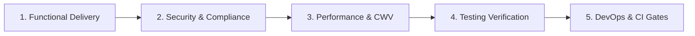

# Mirage Pharma — Tier Implementation Guide & Execution Protocol

This guide defines the standard operating procedure (SOP) and verification checklist for executing any tier from [`docs/roadmap_phases.md`](file:///e:/programming/Space%20Work/MIrage/docs/roadmap_phases.md).

---

## 1. Architectural Guardrails & Standards

* **Workspace Monorepo:** Turborepo + pnpm workspaces (`apps/web`, `apps/admin`, `packages/ui`, `packages/types`, `packages/config`, `packages/utils`, `backend`, `supabase`).
* **Framework:** Next.js 15+ (App Router), React 19, TypeScript strict mode.
* **Official Brand Colors:**
  - `primary`: `#2878BC` (Medical Blue)
  - `navy`: `#023368` (Deep Pharma Navy)
  - `green`: `#35AB38` (Vitality Green)
  - `cyan`: `#308995` / `#61C0E4` (Bio-Glass Cyan)
  - `surface`: `#F8FAFC` / `#FFFFFF` (Clinical Neutral)
  - `border`: `#E2E8F0` (Precision Hairline)

---

## 2. The 5-Pillar Mandatory Tier Checklist

Every tier must satisfy all 5 pillars before being marked as complete:



### Pillar 1: Functional Delivery
- [ ] Code is modular and colocated properly (`packages/ui`, `apps/web/features/*`, etc.).
- [ ] Design tokens strictly imported from `@mirage/config` or Tailwind theme (no rogue hex codes).
- [ ] Responsive across all viewport breakpoints (`sm`, `md`, `lg`, `xl`, `2xl`).
- [ ] Full keyboard navigation and semantic HTML (`aria-label`, landmarks, focus rings).

### Pillar 2: Security & Compliance
- [ ] Strict Content Security Policy (CSP) compliance (no inline `eval`, unsafe scripts).
- [ ] User inputs / rich text sanitized via DOMPurify.
- [ ] Zero exposed credentials or secrets.
- [ ] Compliance standards verified where relevant (HIPAA, FDA 21 CFR Part 11, GDPR).

### Pillar 3: Performance & Core Web Vitals
- [ ] Largest Contentful Paint (LCP) < 1.2s.
- [ ] Cumulative Layout Shift (CLS) = 0.
- [ ] Interaction to Next Paint (INP) < 100ms.
- [ ] WebGL & animations strictly maintain 60fps; `prefers-reduced-motion` respected.
- [ ] Dynamic imports / code-splitting for heavy libraries (Three.js, Lucide, Recharts).

### Pillar 4: Testing & Quality Assurance
- [ ] **Unit Tests (Vitest):** Core logic, utility functions, component states.
- [ ] **E2E Tests (Playwright):** Critical user paths and interactions.
- [ ] **Accessibility:** Clean run with `@axe-core/playwright` (0 critical/serious violations).
- [ ] **Visual Regression:** Key viewports verified against design snapshots.

### Pillar 5: DevOps & CI/CD Gates
- [ ] Type check passes cleanly (`pnpm type-check`).
- [ ] Lint & code style pass (`pnpm lint`).
- [ ] Monorepo build passes with Turbo cache valid (`pnpm build`).
- [ ] Environment variables validated via Zod schema.

---

## 3. Dedicated Subagent Guide: `roadmap_tier_guide`

When working on any tier, invoke the guide subagent to inspect the blueprint and validate the output:

```json
{
  "TypeName": "roadmap_tier_guide",
  "Role": "Tier Architectural Guardian",
  "Prompt": "Review and guide Phase X - Tier Y execution against the 5 pillars."
}
```
